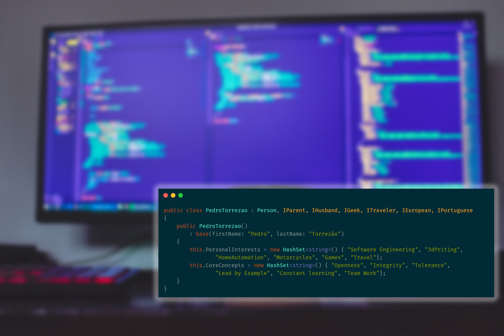

# Olá 👋
## O que é um Programador?

Programar é como ser um professor de computadores:
ensinamos a máquina a fazer tarefas, passo a passo.

---

# Um Programador é...
- Um "professor de computadores" 👨‍🏫💻
- Alguém que escreve instruções para a máquina perceber
- Quem transforma ideias em aplicações, jogos e sites
- Um resolvedor de problemas no dia a dia
- Um aprendiz constante 🚀

---

# Onde existe programação?

- Jogos 🎮
- Telemóveis 📱
- YouTube / TikTok / Instagram 🌐
- Robôs 🤖
- Semáforos, carros, eletrodomésticos 🏠

---

# Como pensa um programador?
1. Perceber o problema
2. Dividir em passos pequenos
3. Testar
4. Corrigir erros (bugs)
5. Melhorar

> Errar faz parte. Melhorar também.

---

# Palavras importantes
- **Algoritmo**: sequência de passos
- **Bug**: erro no programa
- **Debug**: procurar e corrigir bugs
- **Loop**: repetir uma ação
- **Condição**: "se acontecer isto, faz aquilo"

---

# Também sou professor 
## Engenharia de Software

No Instituto Politécnico de Santarém,
ajudo futuros programadores a:

- Pensar como engenheiros
- Criar software com qualidade
- Trabalhar em equipa
- Resolver problemas reais

---

# Exercício 1: Robô 🤖

## Missão
Dar instruções a um “robô” (colega) para sair de um ponto A e chegar ao ponto B.

Regras:
- Só podes usar comandos simples:
  - `andar 1 passo`
  - `virar à esquerda`
  - `virar à direita`
  - `parar`
- O robot segue **exatamente** o que disseres.

--- 

# Mensagem final
Programar não é só escrever código.

- Pensar
- Criar
- Testar
- Trabalhar em equipa
- Nunca desistir 💡

## Obrigado! 🙌

